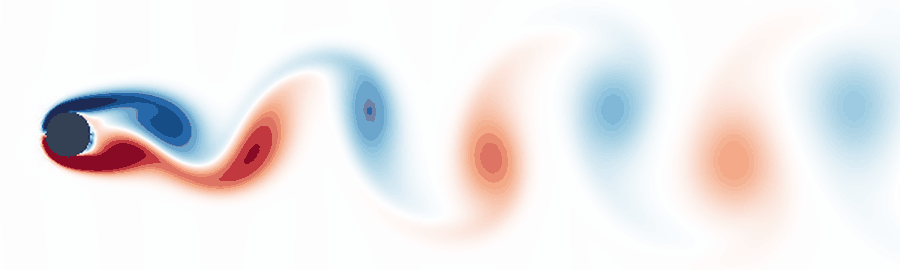

<p align="center">
  
</p>

<h1 align="center">Flow Physics in Simulation</h1>

<p align="center">
  Short, validated simulations that explain one idea in fluid mechanics or heat transfer at a time,<br>
  from textbook fundamentals to research-level topics.
</p>

<p align="center">
  <a href="LICENSE"></a>
  <a href="#license"></a>
  
  <a href="https://orcid.org/0000-0002-3152-6000"></a>
</p>

---

Every episode is a self-contained folder with the solver, the post-processing script, the raw results
and a write-up that compares the numbers with published experiments and benchmarks. The aim is to make each figure
**reproducible**, so you can check every number yourself and build on the code.

## Episodes

| Nº | Topic | Method | Key result | Folder |
|:--:|---|---|---|---|
| 01 | **When does a wake start to oscillate?** Flow past a circular cylinder at Re = 40 and Re = 100 | Lattice Boltzmann (D2Q9, BGK), Python + Numba | St = 0.166 (exp. 0.164); L/D = 2.31 (lit. 2.13–2.35) | [`episodes/01-vortex-street`](episodes/01-vortex-street) |
| 02 | **Why isn't blood flow parabolic?** Pulsatile (Womersley) flow in a tube at α = 1, 5 and 15 | Unsteady Navier–Stokes, finite volumes + Crank–Nicolson, Python | Max. error vs exact solution 0.003 %; flow lags pressure by 84° at α = 15 | [`episodes/02-womersley`](episodes/02-womersley) |
| 03 | **When does heated air start to move?** Rayleigh–Bénard convection at Ra = 1,500, 10⁴ and 10⁶ | Thermal lattice Boltzmann (D2Q9 + D2Q5, TRT), Python + Numba | Ra_c = 1707.7 (theory 1707.76); Nu within 0.3 % of Clever & Busse | [`episodes/03-rayleigh-benard`](episodes/03-rayleigh-benard) |

New episodes are added as the series continues. Topics in preparation include lid-driven cavity flow,
microchannel heat sinks with nanofluids and blood flow through a narrowed artery.

## Quick start

```bash
git clone https://github.com/HamidrezaToloueinasab/flow-physics-in-simulation.git
cd flow-physics-in-simulation
python -m venv .venv
.venv/bin/pip install -r requirements.txt      # Windows: .venv\Scripts\pip install -r requirements.txt

cd episodes/01-vortex-street
python cylinder_lbm.py --out run                 # simulation  -> run/results.json, frames, probe signal
python render.py --data run --media media        # 1080×1080 video, cover frame and validation plot
```

## Repository layout

```
flow-physics-in-simulation/
├── episodes/
│   ├── 01-vortex-street/      solver, renderer, results and write-up for one episode
│   ├── 02-womersley/
│   └── 03-rayleigh-benard/
├── style/                     shared figure style: colours, typography (bundled OFL fonts) and the HT logo
├── requirements.txt
├── CITATION.cff
└── LICENSE
```

## About the author

**Hamidreza Toloueinasab**: CFD engineer and researcher, University of Tabriz.
Research areas: fluid–structure interaction in biofluid mechanics, conjugate heat transfer, nanofluids and thermal management.

[Google Scholar](https://scholar.google.com/citations?user=7PVHHZoAAAAJ&hl=en) ·
[ORCID](https://orcid.org/0000-0002-3152-6000) ·
[LinkedIn](https://www.linkedin.com/in/hamidreza-toloueinasab/)

## Citing

If this material helps your teaching or research, please cite it using the metadata in [`CITATION.cff`](CITATION.cff)
(GitHub shows a **Cite this repository** button in the sidebar).

## License

- **Code:** [MIT](LICENSE).
- **Figures and videos** in `episodes/*/media`: [CC BY 4.0](https://creativecommons.org/licenses/by/4.0/). Reuse them freely with attribution to Hamidreza Toloueinasab.
- **Fonts** in `style/fonts`: Fraunces and Inter, both [SIL Open Font License 1.1](style/fonts).
- **Logo:** the HT monogram (`style/logo.py`) is the author's personal mark and is not licensed for reuse.
