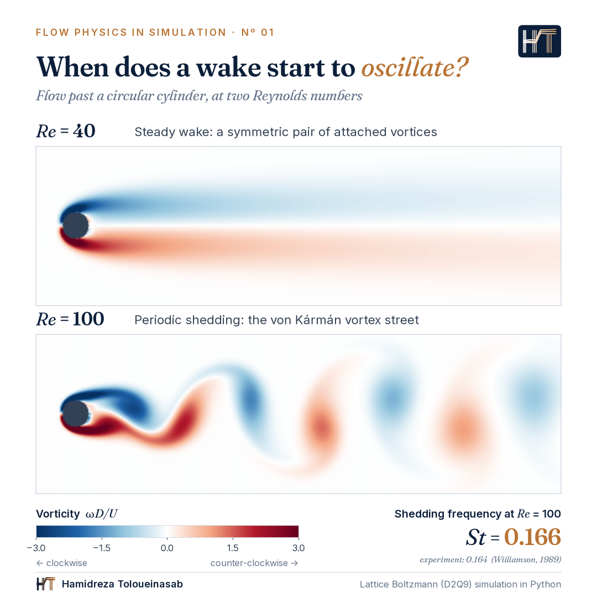
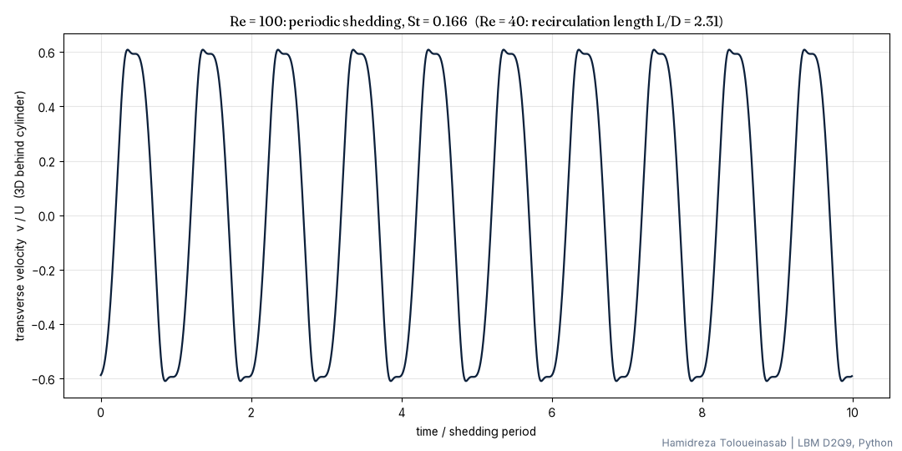

# Nº 01 · When does a wake start to oscillate?

<p align="center">
  
</p>

<p align="center"><a href="media/vortex_street.mp4"><b>▶ Watch the video (MP4, 13 s)</b></a></p>

Same cylinder. Change one number, the Reynolds number Re = UD/ν, and the wake goes from perfectly
steady to rhythmically alive.

| | Re = 40 | Re = 100 |
|---|---|---|
| Wake | Two steady, mirror-image vortices stay attached behind the cylinder | Vortices peel off alternately from the top and bottom: the **von Kármán vortex street** |
| Measured quantity | Recirculation length **L/D = 2.31** | Strouhal number **St = fD/U = 0.166** |
| Literature | reference solution 2.24; published values 2.13 to 2.35 (Gautier et al., 2013) | 0.164 (experiment) |

The symmetric wake loses stability at a critical Reynolds number of about **Re ≈ 47** (Provansal et al., 1987) through a
Hopf bifurcation. Above it, the wake oscillates at a well-defined frequency. Flow remains essentially two-dimensional
up to Re ≈ 190 (Williamson, 1996), so a 2D model is appropriate for both cases.

## Why it matters

- **Vortex flowmeters** infer the flow rate from the shedding frequency through the Strouhal number.
- **Vortex-induced vibration** of tall structures such as chimneys can be driven by periodic shedding.
- **Pin-fin cooling:** in arrays for turbine blades, shedding can help heat transfer on the pins themselves, while rows
  further downstream can lose some (Ostanek & Thole, 2012).

## Method

| | |
|---|---|
| Solver | Lattice Boltzmann method, D2Q9 lattice, BGK collision (`cylinder_lbm.py`) |
| Implementation | Fused pull-streaming and collision, parallelised with Numba |
| Cylinder | Half-way bounce-back (no-slip), diameter D = 30 lattice cells |
| Inlet / outlet | Equilibrium velocity inlet, U = 0.06 (Mach ≈ 0.1); zero-gradient outlet |
| Lateral boundaries | Periodic, spacing 20D (blockage 5 %) |
| Domain | Inlet 15D upstream and outlet 25D downstream of the cylinder centre; 1200 × 600 cells |
| Run length | 120 000 warm-up steps and 30 000 recorded steps (about 10 shedding periods) |
| Strouhal number | Mean period from upward zero crossings of the transverse velocity 3D behind the cylinder |
| Recirculation length | Distance from the rear of the cylinder to where the centreline velocity changes sign |

Both Reynolds numbers run side by side on identical grids; only the viscosity (relaxation time τ = 0.635 and 0.554) differs.

## Validation and convergence

| D (cells) | Periodic spacing | Inlet distance | St (Re = 100) | L/D (Re = 40) |
|:--:|:--:|:--:|:--:|:--:|
| 20 | 10D | 5D | 0.1745 | 2.32 |
| 30 | 20D | 5D | 0.1735 | 2.41 |
| 20 | 20D | 5D | 0.1717 | 2.49 |
| 20 | 20D | 15D | 0.1647 | 2.39 |
| **30** | **20D** | **15D** | **0.1665** | **2.31** |

**Lesson:** for the Strouhal number, the distance from the inlet to the cylinder mattered more than grid resolution: moving
the inlet from 5D to 15D lowered St by 4 %, while refining from D = 20 to 30 changed it by 1 %. For L/D the two effects are
similar (4 % and 3 %). The final St is 1.5 % above experiment and L/D is 3 % above the reference solution of 2.24. The grid
changes show that the results are not fully grid-independent. Result files are stored for two of the four preliminary rows.

Results of the final run are in [`results/results.json`](results/results.json), and two of the convergence runs are in
[`results/convergence`](results/convergence).

<p align="center">
  
</p>

## Reproduce

```bash
pip install -r ../../requirements.txt
python cylinder_lbm.py --out run                  # defaults reproduce the final run above
python render.py --data run --media media         # video, cover and validation plot
```

The run writes about 0.7 GB of vorticity frames (`run/frames.npz`) for the video. For a quick test use a coarse grid:

```bash
python cylinder_lbm.py --out quick --D 10 --warmup 30000 --record 6000 --frame_every 1000
```

Run `python cylinder_lbm.py --help` to list all options (grid size, domain extent, run length).

## Files

| File | Purpose |
|---|---|
| `cylinder_lbm.py` | Simulation; writes `results.json`, `probe.npy` and `frames.npz` |
| `render.py` | Video (1080 × 1080, 30 fps), cover frame and validation figure |
| `results/` | Results of the final run and of the convergence study |
| `media/` | Published video, cover, validation figure and README animation |

## References

1. C. H. K. Williamson, *Oblique and parallel modes of vortex shedding in the wake of a circular cylinder at low Reynolds numbers*, J. Fluid Mech. **206** (1989) 579–627. [doi:10.1017/S0022112089002429](https://doi.org/10.1017/S0022112089002429)
2. M. Provansal, C. Mathis, L. Boyer, *Bénard–von Kármán instability: transient and forced regimes*, J. Fluid Mech. **182** (1987) 1–22. [doi:10.1017/S0022112087002222](https://doi.org/10.1017/S0022112087002222)
3. M. Coutanceau, R. Bouard, *Experimental determination of the main features of the viscous flow in the wake of a circular cylinder in uniform translation. Part 1*, J. Fluid Mech. **79** (1977) 231–256. [doi:10.1017/S0022112077000135](https://doi.org/10.1017/S0022112077000135)
4. B. Fornberg, *A numerical study of steady viscous flow past a circular cylinder*, J. Fluid Mech. **98** (1980) 819–855.
5. S. C. R. Dennis, G.-Z. Chang, *Numerical solutions for steady flow past a circular cylinder at Reynolds numbers up to 100*, J. Fluid Mech. **42** (1970) 471–489.
6. C. H. K. Williamson, *Vortex dynamics in the cylinder wake*, Annu. Rev. Fluid Mech. **28** (1996) 477–539.
7. R. Gautier, D. Biau, E. Lamballais, *A reference solution of the flow over a circular cylinder at Re = 40*, Comput. Fluids **75** (2013) 103–111. [arXiv:1310.6641](https://arxiv.org/abs/1310.6641)
8. J. K. Ostanek, K. A. Thole, *Effects of varying streamwise and spanwise spacing in pin-fin arrays*, ASME Turbo Expo 2012, GT2012-68127. [doi:10.1115/GT2012-68127](https://doi.org/10.1115/GT2012-68127)
9. NASA Earth Observatory, *Swirly clouds in the Canaries*: [vortex streets in nature](https://earthobservatory.nasa.gov/images/151216/swirly-clouds-in-the-canaries).

---

Discussed on LinkedIn: [Flow Physics in Simulation Nº 01](https://lnkd.in/p/ddTvj2Vi)
