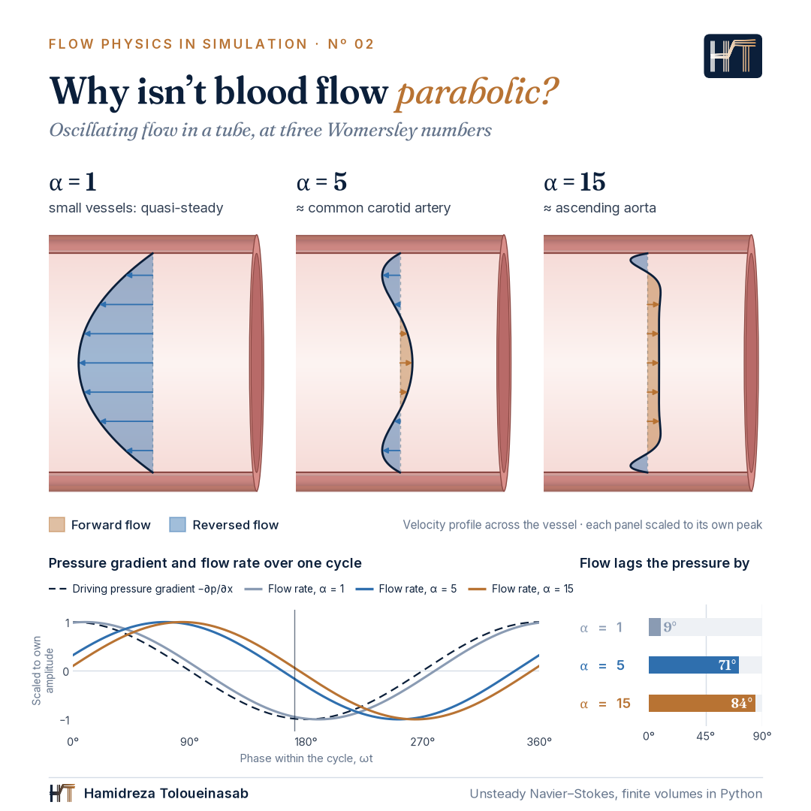
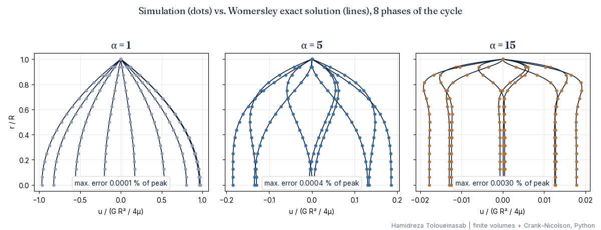

# Nº 02 · Why isn't blood flow parabolic?

<p align="center">
  
</p>

<p align="center"><a href="media/womersley.mp4"><b>▶ Watch the video (MP4, 12 s)</b></a></p>

Textbooks draw flow in a tube as a parabola. That holds for steady flow. When the flow is driven back and forth, as
blood is by the heartbeat, the shape depends on one number, the **Womersley number**:

$$\alpha = R\sqrt{\omega/\nu}$$

It compares how fast the flow is driven back and forth (ω) with how fast viscosity (ν) carries momentum in from the wall
across the radius R.

| | α = 1 | α = 5 | α = 15 |
|---|---|---|---|
| Typical vessel | small vessels | ≈ common carotid artery | ≈ ascending aorta |
| Profile | parabolic, quasi-steady | flattening; near-wall flow reverses first | flat plug with thin wall layers |
| Flow rate lags the pressure gradient by | 9.5° | 71.4° | 84.3° |
| Oscillating flow / quasi-steady Poiseuille estimate | 0.99 | 0.24 | 0.032 |
| Wall shear stress leads the flow by | 2.4° | 31.0° | 40.8° |

In-vivo human values for comparison (Williamson et al., 2024): ascending aorta α ≈ 15.0–20.6; common carotid
α ≈ 5.7–6.5.

## Why it matters

- **Wall shear stress** oscillates out of phase with the flow. Regions of low, oscillating shear correlate with
  where atherosclerotic plaques form (Ku et al., 1985).
- **Boundary conditions:** a parabolic (Poiseuille) inlet profile is the wrong choice for pulsatile CFD of large arteries.
- **Viscous layer:** at α = 15 viscosity acts only in a Stokes layer of thickness √2·R/α ≈ 0.09 R.

## Model and method

| | |
|---|---|
| Flow | Fully developed, laminar, Newtonian, rigid circular tube |
| Driving | Sinusoidal pressure gradient −∂p/∂x = G cos ωt |
| Governing equation | Axial Navier–Stokes, which reduces exactly to α² ∂u/∂t = 4 cos t + (1/r) ∂/∂r (r ∂u/∂r) (non-dimensional) |
| Discretisation | Second-order finite volumes in r (400 cells), Crank–Nicolson in time (4000 steps per cycle) |
| Start-up | From rest, 60 cycles, so the start-up transient has decayed to below 10⁻⁴ |
| Outputs | Profiles over the last cycle; flow rate, wall shear stress and their phases |

## Validation against Womersley's exact solution

The exact periodic solution (Womersley, 1955) is

$$u = \mathrm{Re}\left\{\frac{4}{i\alpha^2}\left[1-\frac{J_0(i^{3/2}\alpha r)}{J_0(i^{3/2}\alpha)}\right]e^{it}\right\}$$

| α | Largest profile error (relative to peak) | Flow lag, simulation / exact |
|:--:|:--:|:--:|
| 1 | 0.0001 % | 9.49° / 9.45° |
| 5 | 0.0004 % | 71.41° / 71.35° |
| 15 | 0.0030 % | 84.36° / 84.34° |

<p align="center">
  
</p>

## Reproduce

```bash
pip install -r ../../requirements.txt
python womersley.py --out run                    # solver + validation  -> run/results.json, run/profiles.npz
python render.py --data run --media media        # 1080×1080 video, cover frame and validation figure
```

The whole run takes about 15 s on a desktop PC. Use `--alphas 2 8 20` to explore other Womersley numbers.

## Limits

- The walls are rigid and straight, the fluid is Newtonian, and the driving has a single harmonic.
- Real arteries are elastic, curved and branched, and the cardiac waveform contains many harmonics.
- Womersley's linear theory handles multiple harmonics by superposition. Wall elasticity and geometry need full 3D (FSI) simulation.

## References

1. J. R. Womersley, *Method for the calculation of velocity, rate of flow and viscous drag in arteries when the pressure gradient is known*, J. Physiol. **127** (1955) 553–563. [doi:10.1113/jphysiol.1955.sp005276](https://doi.org/10.1113/jphysiol.1955.sp005276)
2. P. N. Williamson, P. D. Docherty, M. Jermy, B. M. Steven, *Literature survey for in-vivo Reynolds and Womersley numbers of various arteries and implications for compliant in-vitro modelling*, Cardiovasc. Eng. Technol. **15** (2024) 418–430. [doi:10.1007/s13239-024-00723-4](https://doi.org/10.1007/s13239-024-00723-4)
3. D. N. Ku, D. P. Giddens, C. K. Zarins, S. Glagov, *Pulsatile flow and atherosclerosis in the human carotid bifurcation: positive correlation between plaque location and low oscillating shear stress*, Arteriosclerosis **5** (1985) 293–302. [doi:10.1161/01.ATV.5.3.293](https://doi.org/10.1161/01.ATV.5.3.293)
4. D. N. Ku, *Blood flow in arteries*, Annu. Rev. Fluid Mech. **29** (1997) 399–434. [doi:10.1146/annurev.fluid.29.1.399](https://doi.org/10.1146/annurev.fluid.29.1.399)
