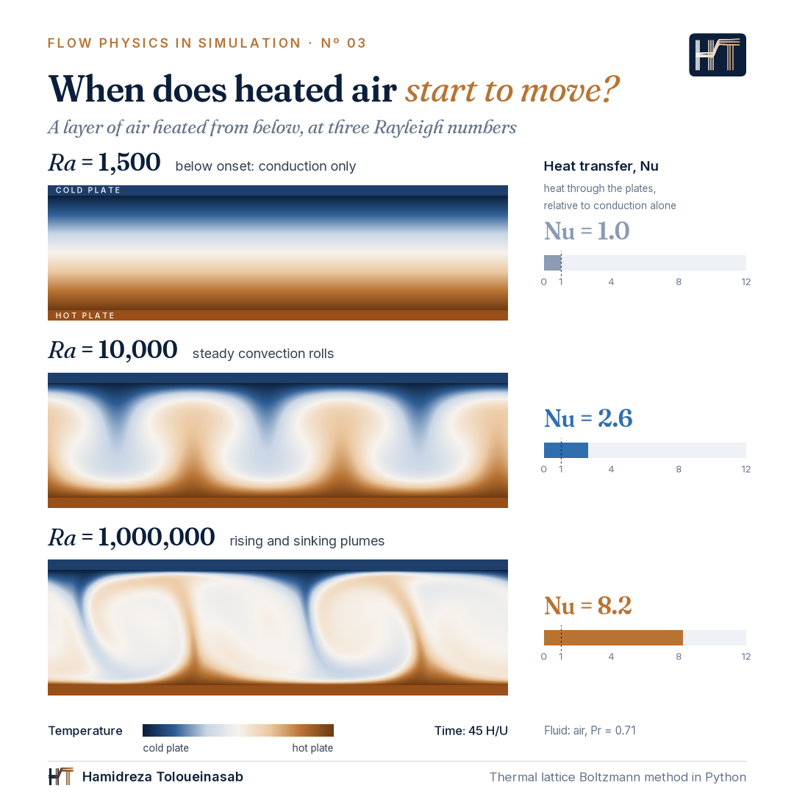
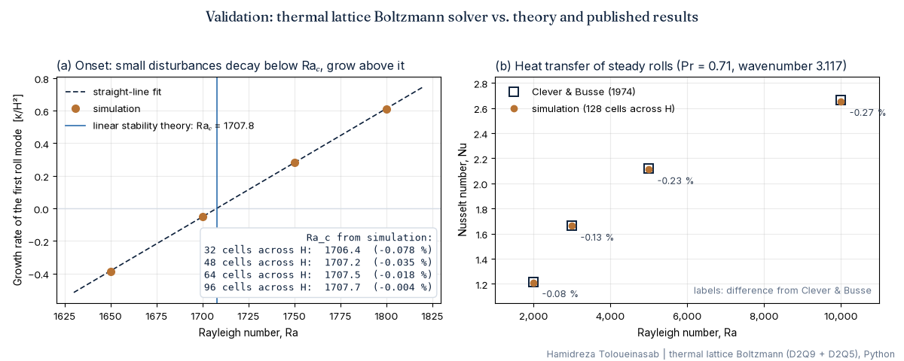

# Nº 03 · When does heated air start to move?

<p align="center">
  
</p>

<p align="center"><a href="media/rayleigh_benard.mp4"><b>▶ Watch the video (MP4, 12 s)</b></a></p>

Warm air rises, yet a layer of air heated from below can stay perfectly still. Buoyancy has to overcome viscosity and
heat diffusion, which damp every small disturbance. The balance is measured by the **Rayleigh number**

$$\mathrm{Ra} = \frac{g\beta\,\Delta T\,H^3}{\nu\kappa}$$

with g gravity, β the thermal expansion coefficient, ΔT the plate temperature difference, H the layer depth, ν the
kinematic viscosity and κ the thermal diffusivity. Between two rigid plates, linear stability theory predicts that
convection starts at **Ra_c = 1707.76**, as rolls of wavenumber 3.117/H (each roll about as wide as the layer is deep).

| | Ra = 1,500 | Ra = 10,000 | Ra = 1,000,000 |
|---|---|---|---|
| State | at rest, pure conduction | six steady rolls in a layer 4H wide (each about 0.67 H wide) | unsteady plumes |
| Nusselt number (heat transfer / conduction) | 1.00 | 2.62 | 8.2 (time average) |

The video starts all three layers from the conduction state with the same tiny random temperature noise.
Below onset the noise decays. At Ra = 10⁶ plumes erupt after about 10–13 free-fall times (H/U, with U = √(gβΔT H));
at Ra = 10,000 the rolls appear only after about 22–28.

## Convection on a larger scale

The Sun's surface is covered in granules about 1,000 km across, the tops of convection cells where hot fluid rises ([NASA/Marshall](https://solarscience.msfc.nasa.gov/feature1.shtml)).

## Why it matters

- **Insulation:** still air is a good insulator, but only below the threshold. Ra scales with the cube of the gap
  thickness, so a gap twice as thick has a Rayleigh number eight times larger. It may start to convect, and the extra
  thickness then insulates less than expected.
- **Simulation:** convection takes time to build up from a tiny disturbance. In the video, the Ra = 10,000 layer stays
  perfectly still for the first third (about 22 free-fall times) before the rolls form. A natural-convection run stopped
  as soon as it looks steady can miss the convection and underpredict the heat transfer.

## Model and method

| | |
|---|---|
| Flow | 2D, Boussinesq, between rigid isothermal plates (hot below, cold above); periodic sideways |
| Fluid | air, Pr = ν/κ = 0.71 |
| Method | double-distribution lattice Boltzmann: D2Q9 (flow, Guo forcing) + D2Q5 (temperature), two-relaxation-time collisions |
| Boundaries | half-way bounce-back (no slip) and anti-bounce-back (fixed temperature) |
| Resolution | movie: 128 cells across the layer, 4H wide; validation: up to 128 cells, one roll pair (2.016 H) |
| Nusselt number | Nu = 1 + ⟨u_y T⟩ H/(κ ΔT) (volume average), cross-checked with the wall temperature gradient |

## Validation

<p align="center">
  
</p>

**Onset.** Starting from the conduction state plus a tiny disturbance, the disturbance decays below Ra_c and grows above it.
Extrapolating the growth rate to zero:

| Cells across the layer | 32 | 48 | 64 | 96 | Theory |
|---|:--:|:--:|:--:|:--:|:--:|
| Ra_c | 1706.4 | 1707.2 | 1707.5 | 1707.7 | 1707.76 |

**Heat transfer of steady rolls** (Pr = 0.71, wavenumber 3.117), 128 cells across the layer:

| Ra | Simulation | Clever & Busse (1974) | Difference |
|:--:|:--:|:--:|:--:|
| 2,000 | 1.211 | 1.212 | −0.08 % |
| 3,000 | 1.661 | 1.663 | −0.13 % |
| 5,000 | 2.111 | 2.116 | −0.23 % |
| 10,000 | 2.654 | 2.661 | −0.27 % |

Clever & Busse estimate their own values to be within ½–1 % of the exact ones.

**Ra = 10⁶:** time-averaged Nu = 8.25 with 128 cells and 8.25 with 192 cells across the layer.

## Reproduce

```bash
pip install -r ../../requirements.txt
python rb_lbm.py onset --out run --H 96                       # critical Rayleigh number (~1 min)
python rb_lbm.py rolls --out run --H 128                      # steady-roll Nusselt numbers (~2 min)
python rb_lbm.py movie --out run --H 128 --Uff 0.1 --aspect 4 --t_end 66 --frame_tff 0.2 --t_avg 300
python render.py --data run --media media                     # video, cover and validation figure
```

`render.py` expects the onset runs for 32, 48, 64 and 96 cells (`--H 32`, …) in the same `run` folder.

## Limits

- The simulation is two-dimensional. Real layers at Ra = 10⁶ are three-dimensional and their Nusselt number differs.
- At high Ra the Nusselt number also depends on the domain width and the number of rolls that form.
- The plates are perfectly conducting and the fluid properties are constant (Boussinesq approximation).

## References

1. S. Chandrasekhar, *Hydrodynamic and Hydromagnetic Stability*, Oxford University Press (1961).
2. R. M. Clever, F. H. Busse, *Transition to time-dependent convection*, J. Fluid Mech. **65** (1974) 625–645. [doi:10.1017/S0022112074001571](https://doi.org/10.1017/S0022112074001571)
3. X. Shan, *Simulation of Rayleigh–Bénard convection using a lattice Boltzmann method*, Phys. Rev. E **55** (1997) 2780–2788. [doi:10.1103/PhysRevE.55.2780](https://doi.org/10.1103/PhysRevE.55.2780)
