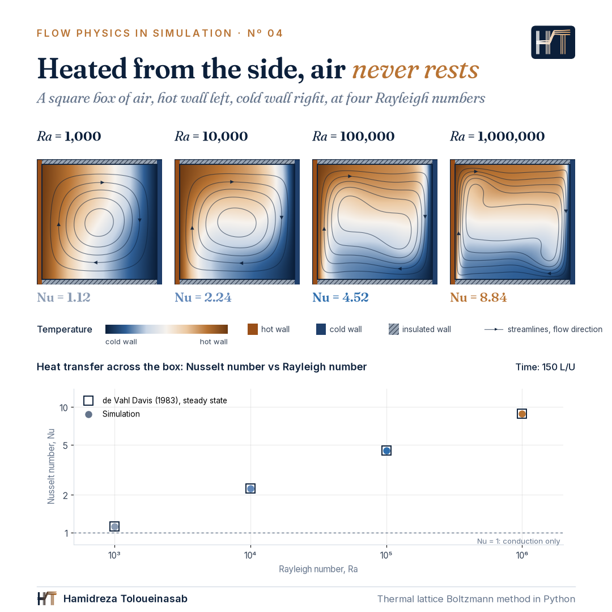
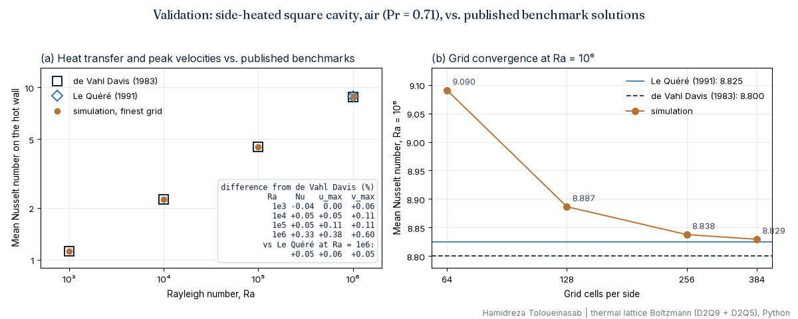

# Nº 04 · Heated from the side, air never rests

<p align="center">
  
</p>

<p align="center"><a href="media/cavity.mp4"><b>▶ Watch the video (MP4, 12 s)</b></a></p>

In [episode 03](../03-rayleigh-benard), air heated from below stayed perfectly still until the Rayleigh number passed
about 1708. Heated from the side, it never rests. Air can only be at rest if gravity is balanced by pressure, which
requires warm and cool air to lie in horizontal layers (∇p = ρg implies ∇ρ × g = 0). A hot wall next to a cold wall
puts light and heavy air side by side, so a circulation starts at any temperature difference: the critical Rayleigh
number is zero.

The case is the classic benchmark of de Vahl Davis (1983): a square cavity of air (Pr = 0.71), hot left wall, cold
right wall, insulated top and bottom, at

$$\mathrm{Ra} = \frac{g\beta\,\Delta T\,L^3}{\nu\kappa} = 10^3,\ 10^4,\ 10^5,\ 10^6$$

| | Ra = 1,000 | Ra = 10,000 | Ra = 100,000 | Ra = 1,000,000 |
|---|---|---|---|---|
| Flow | slow loop | flow starts to carry the heat | thin layers along the walls | fast wall jets around a calm, layered core |
| Mean Nusselt number | 1.118 | 2.244 | 4.521 | 8.830 |
| Wall-layer thickness at mid-height | 0.44 L | 0.21 L | 0.11 L | 0.06 L |

For scale: for air with a 20 °C difference, a 1 cm cavity has Ra ≈ 2,000 and a 10 cm cavity about 2 × 10⁶.

The video starts every cavity from still air at the mean temperature. The early transient (t = 0.1–12 L/U, with
U = √(gβΔT L)) is shown in slow motion, the approach to the steady state up to t = 60 is played six times faster, and
the steady state is held at the end; the playback speed is shown on screen.

## Why it matters

- **Windows:** the air gap in double glazing is a tall, narrow version of this cavity. Guidance puts the best gap at
  roughly 12–16 mm: narrower gaps conduct more heat straight across, wider gaps let the air circulate and carry heat.
- **Simulation:** at high Ra almost all of the temperature change happens in thin wall layers (about 6 % of the width
  at Ra = 10⁶). On a 64-cell grid the heat transfer at Ra = 10⁶ came out 3 % too high.

## Model and method

| | |
|---|---|
| Flow | 2D, Boussinesq, laminar, steady state reached by time stepping |
| Fluid | air, Pr = ν/κ = 0.71 |
| Method | double-distribution lattice Boltzmann: D2Q9 (flow, Guo forcing) + D2Q5 (temperature), two-relaxation-time collisions |
| Boundaries | half-way bounce-back (no slip); anti-bounce-back (fixed temperature) on the side walls; bounce-back (zero heat flux) on top and bottom |
| Grids | 64, 128, 256 and 384 cells per side |
| Outputs | mean and local Nusselt number on the hot wall, Nu on the mid-plane, peak velocities on the mid-lines (units κ/L) |

## Validation

<p align="center">
  
</p>

Finest grid (256 cells per side for Ra ≤ 10⁴, 384 for Ra ≥ 10⁵) against de Vahl Davis (1983, Table V):

| Ra | Nu (sim / ref) | u_max on x = ½ (sim / ref) | v_max on y = ½ (sim / ref) | Nu_max on the hot wall (sim / ref) |
|:--:|:--:|:--:|:--:|:--:|
| 10³ | 1.1176 / 1.118 | 3.649 / 3.649 | 3.699 / 3.697 | 1.507 / 1.505 |
| 10⁴ | 2.2442 / 2.243 | 16.19 / 16.18 | 19.64 / 19.62 | 3.536 / 3.528 |
| 10⁵ | 4.5212 / 4.519 | 34.77 / 34.73 | 68.66 / 68.59 | 7.735 / 7.717 |
| 10⁶ | 8.8295 / 8.800 | 64.87 / 64.63 | 220.7 / 219.4 | 17.71 / 17.93 |

Peak-velocity positions agree with the reference to within one grid cell. The position of Nu_max differs by 0.005 L at Ra = 10³ (0.087 against 0.092, about 1.2 cells) and by less than one cell at the other Ra. De Vahl Davis estimates his own values to be
accurate to 0.1, 0.2, 0.3 and 1 % for the four Rayleigh numbers. Against the spectral solution of Le Quéré (1991) at
Ra = 10⁶ (Nu = 8.825, u_max = 64.83, v_max = 220.6, Nu_max = 17.54), the differences are +0.05, +0.06, +0.05 and +1.0 %;
the local maximum Nu_max is the slowest quantity to converge with the grid.

Grid convergence of the mean Nusselt number at Ra = 10⁶: 9.090 (64), 8.887 (128), 8.838 (256), 8.830 (384 cells).

## Reproduce

```bash
pip install -r ../../requirements.txt
python cavity_lbm.py bench --out run --L 64                  # repeat with --L 128, 256 (and 384 --ras 1e5 1e6)
python cavity_lbm.py movie --out run/movie --L 256 --stride 2 --t_end 150 --frame_tff 0.5 --t_fine 20 --frame_fine 0.1
python render.py --data run --media media --validation_only   # validation figures
python render.py --data run/movie --media media --layout chart # video and cover
```

The 256-cell benchmark takes about two minutes on a desktop PC; the movie run about six.

## Limits

- Two-dimensional, laminar and steady (at Ra = 10⁶ the flow is still steady in 2D; at much higher Ra it becomes unsteady).
- Constant fluid properties (Boussinesq approximation); radiation between the walls, which matters in real windows, is not included.
- Perfectly conducting side walls and perfectly insulated top and bottom.

## References

1. G. de Vahl Davis, *Natural convection of air in a square cavity: a bench mark numerical solution*, Int. J. Numer. Methods Fluids **3** (1983) 249–264. [doi:10.1002/fld.1650030305](https://doi.org/10.1002/fld.1650030305)
2. P. Le Quéré, *Accurate solutions to the square thermally driven cavity at high Rayleigh number*, Comput. Fluids **20** (1991) 29–41. [doi:10.1016/0045-7930(91)90025-D](https://doi.org/10.1016/0045-7930(91)90025-D)
